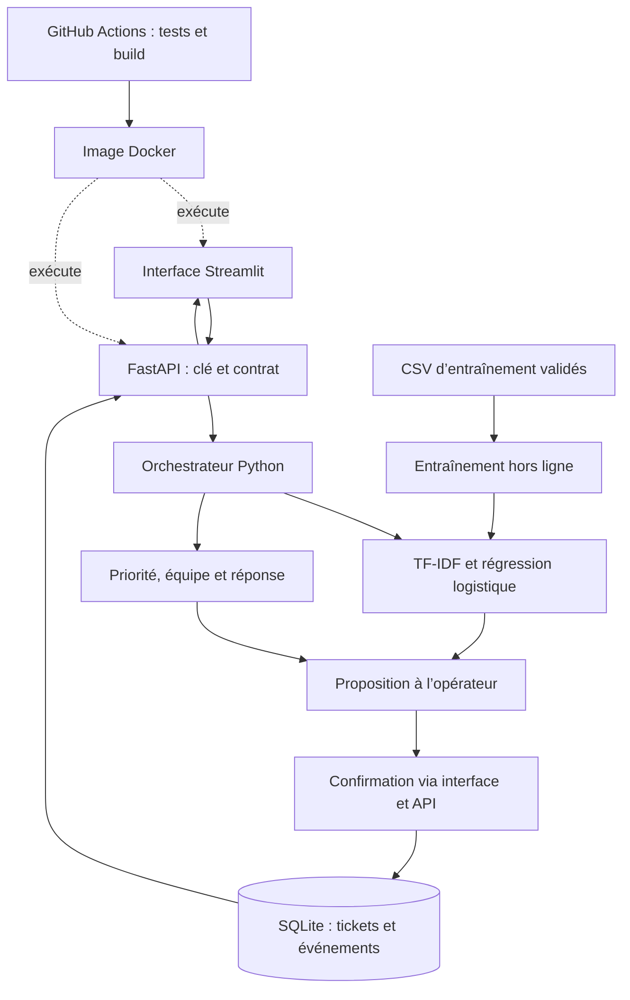
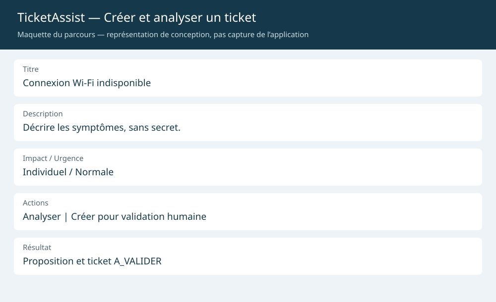
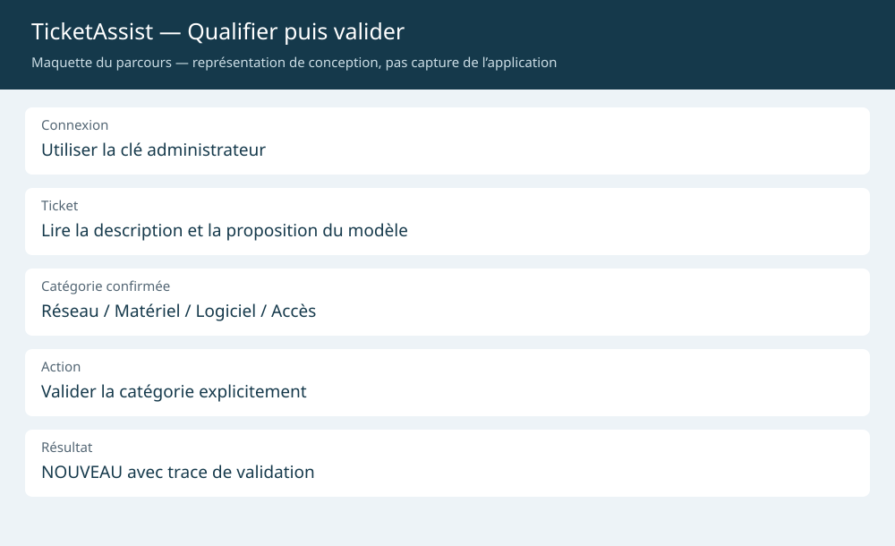
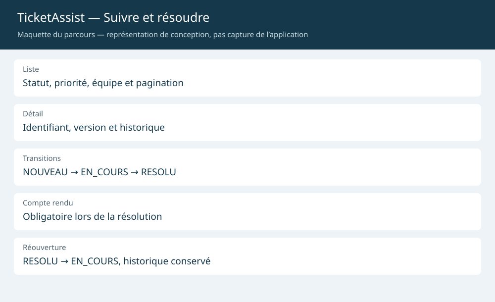
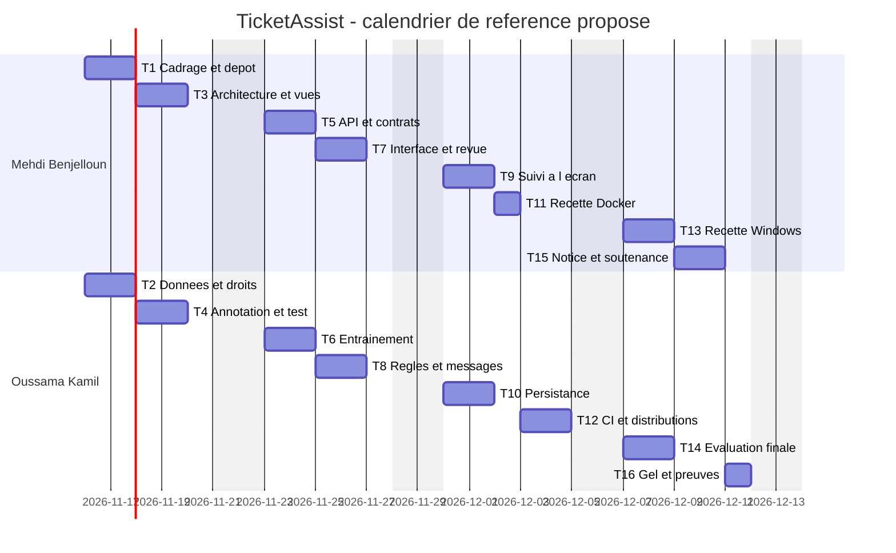

# Dossier de lancement — Semaine 1
## TicketAssist — Agent intelligent de qualification et de suivi des tickets IT

| Identification | Information |
| --- | --- |
| Formation | Projet du cours « Développement et déploiement d’applications intelligentes » |
| Équipe | **Mehdi Benjelloun** · **Oussama Kamil** |
| Dépôt de référence | Projet TicketAssist, évolution métier de Sentiment-app |
| Version du dossier | 1.1 — mise à jour du 11 novembre 2026 |
| Référence du catalogue | Projet n° 10 — Agent de gestion des tickets IT |
| Catégorie / niveau | Support et ITSM / Intermédiaire |
| Sujet professionnel recommandé | Non — mention du catalogue de l’encadrant |
| Horizon de réalisation | Quatre semaines ; calendrier proposé du 16 novembre au 13 décembre 2026 |

**Synthèse.** TicketAssist transforme une description d’incident en proposition de catégorie, priorité, équipe et réponse initiale. Un opérateur confirme la qualification avant traitement ; SQLite conserve le ticket et ses événements. Le démonstrateur est implémenté et testé localement. Ce dossier organise sa remise et sa validation ; il ne reconstitue pas un historique de contributions individuelles.

**Point d’attention pour la validation du sujet.** Le corpus joint est simulé. L’exigence du cours portant sur un échantillon réel reste à satisfaire par un export autorisé et anonymisé, ou par une dérogation explicite de l’enseignant. La licence finale, les relectures, la CI du dépôt distant et le visa enseignant ne sont pas déclarés acquis.

### Gouvernance et répartition du binôme

| Livrable | Rédacteur responsable désigné | Relecteur désigné | Fichier de remise |
| --- | --- | --- | --- |
| 1. Descriptif | Mehdi Benjelloun | Oussama Kamil | `docs/semaine1/1-descriptif.md` |
| 2. Dataset | Oussama Kamil | Mehdi Benjelloun | `docs/semaine1/2-dataset.md` + `data/sample/` |
| 3. Maquette globale | Mehdi Benjelloun | Oussama Kamil | `docs/semaine1/3-maquette.md` + `docs/semaine1/img/` |
| 4. Pipeline | Oussama Kamil, consolidation | Mehdi Benjelloun | `docs/semaine1/4-pipeline.md` |

Les responsables doivent relire et s’approprier les documents préparés avec assistance IA. Chaque membre saisit personnellement ses tâches. Les contributions effectives se prouvent par les commits, pull requests et relectures, pas par la seule présence de son nom.

**Circuit de remise.** Déposer la répartition dans `docs/semaine1/README.md` ; travailler sur quatre branches `semaine1/descriptif`, `semaine1/dataset`, `semaine1/maquette`, `semaine1/pipeline` ; ouvrir une PR par livrable ; obtenir la relecture de l’autre membre ; fusionner les versions approuvées ; créer les issues du planning ; poser le tag `semaine1-remis` sur le commit retenu puis informer l’enseignant. Ces actions restent à confirmer dans GitHub.

## Livrable 1 — Descriptif du projet mis à jour

**Rédacteur responsable : Mehdi Benjelloun** · Relecteur : Oussama Kamil · Relecture à formaliser dans la PR.

### 1.1 Contexte et problème

Un service support reçoit des demandes en texte libre. Le technicien doit les lire, déterminer leur catégorie et leur priorité, choisir l’équipe puis assurer leur suivi. TicketAssist vise à structurer ce premier traitement et à en conserver la traçabilité. Le scénario est pédagogique ; aucun déploiement réel à l’EMSI ou dans une entreprise n’est revendiqué.

### 1.2 Objectif

**Automatiser le tri et l’orientation des demandes IT : lire les tickets, proposer leur catégorie, priorité et équipe, préparer une réponse initiale, puis assurer création et escalade avec contrôle humain.**

### 1.3 Utilisateurs et scénario principal

Le **demandeur**, avec une clé client, crée et consulte les demandes. L’**opérateur**, avec une clé admin, confirme la catégorie et pilote les statuts. Le démonstrateur utilise des rôles partagés, sans isolation par demandeur.

1. Saisir un titre, une description, l’impact et l’urgence dans Streamlit.
2. Consulter la catégorie, le score, la priorité, l’équipe et la réponse initiale proposés.
3. Enregistrer le ticket au statut `A_VALIDER`.
4. L’opérateur confirme ou corrige explicitement la catégorie, puis démarre le traitement.
5. Renseigner un compte rendu pour résoudre ; rouvrir si nécessaire, en conservant l’historique.

### 1.4 Fonctionnalités du MVP — binôme

| ID | Fonctionnalité | Résultat utilisateur et critère observable | Priorité |
| --- | --- | --- | --- |
| F1 | Qualification et orientation | Catégorie parmi quatre classes, score, priorité selon une matrice à neuf combinaisons et équipe proposée | Indispensable |
| F2 | Assistance à la validation | Réponse initiale contrôlée, abstention signalée, escalade P1 et confirmation réservée à l’admin | Indispensable |
| F3 | Gestion du cycle de vie | Identifiant, liste paginée, filtre, détail, compte rendu et historique ; conflit détecté si version dépassée | Indispensable |

Les catégories sont `acces`, `logiciel`, `materiel`, `reseau`. Le seuil initial d’abstention est **0,45** ; un texte entièrement hors vocabulaire est également refusé. La priorité dépend exclusivement de l’impact et de l’urgence : individuel → P4/P4/P3 ; équipe → P4/P3/P2 ; organisation → P3/P2/P1, pour les urgences faible/normale/critique. P1 est la priorité maximale. Cette matrice pédagogique doit être approuvée pour tout usage métier.

### 1.5 Services et composants techniques

| Composant | Rôle | Technologie retenue | Justification |
| --- | --- | --- | --- |
| Modèle ML | F1 : classer les descriptions | TF-IDF + régression logistique scikit-learn | Modèle léger, explicable et exécutable hors ligne |
| Mémoire métier | F3 : tickets et événements | SQLite, transactions et requêtes paramétrées | Persistance simple ; contrôle de version pour les écritures concurrentes |
| Outils de l’agent | F1–F3 : qualifier, prioriser, proposer et enregistrer | Modules Python de `ticket_agent/` | Logique indépendante de HTTP, fonctions directement testables |
| API et contrats | F1–F3 : exposer les services | FastAPI, Pydantic, routes `/v1/tickets` | Validation des entrées, documentation OpenAPI, erreurs explicites |
| Interface | F1–F3 : saisie, revue et suivi | Streamlit, client HTTP | Parcours simple ; aucun accès direct au modèle ou à SQLite |
| Contrôle d’accès | F2/F3 : séparer client et admin | En-tête `X-API-Key` | Toutes les routes métier sont protégées ; la santé reste publique |
| Exécution et qualité | Ensemble du MVP | Paquet installable, Docker, GitHub Actions, pytest/Ruff/mypy | Environnement reconstructible et contrôles automatisés ; Docker/CI distante à confirmer |

Un **orchestrateur unique** coordonne ces modules. Le projet ne revendique ni plusieurs agents autonomes ni une génération par LLM. Le choix de classification et de règles répond à la fiche de l’encadrant ; aucun RAG n’est imposé par celle-ci.

### 1.6 Hors périmètre

Résolution technique autonome, commandes exécutées sur des postes, réinitialisation de mots de passe, connecteurs GLPI/ServiceNow, comptes individuels, SLA contractuels, RAG et déploiement de production multi-organisations. La résolution est déclarée par l’opérateur ; elle n’est pas vérifiée automatiquement sur les équipements.

### 1.7 Alignement sur la fiche officielle du projet n° 10

L’encadrant définit le projet **« Agent de gestion des tickets IT »**, catégorie **Support et ITSM**, niveau **Intermédiaire**, avec l’objectif **« Automatiser le tri et l’orientation des demandes »**. La mention « Sujet professionnel recommandé : Non » est conservée comme attribut du catalogue ; elle ne change pas les exigences de qualité du livrable.

| Fonctionnalité du catalogue | Couverture dans TicketAssist | Regroupement MVP |
| --- | --- | --- |
| Lit les tickets | Reçoit le titre, la description, l’impact et l’urgence via formulaire/API | F1 |
| Les classe automatiquement | Modèle ML à quatre catégories ; score et abstention si nécessaire | F1 |
| Identifie leur priorité | Matrice déterministe impact × urgence ; priorité indépendante du sentiment | F1 |
| Les assigne à la bonne équipe | Propose une équipe puis enregistre l’équipe confirmée lors de la validation admin | F1/F2 |
| Génère une réponse initiale | Gabarit contrôlé demandant les précisions utiles ; affichage à l’opérateur, sans envoi d’e-mail | F2 |
| Crée un ticket si nécessaire | Action explicite de création via API, identifiant SQLite et statut A_VALIDER | F3 |
| Escalade les cas complexes | Signale les faibles confiances, le hors-vocabulaire et P1 ; orientation Support N1 en cas d’abstention | F2/F3 |

**Adaptations de périmètre.** L’outil de tickets du MVP est interne : API et SQLite. Aucun connecteur externe GLPI/ServiceNow n’est fourni. Le titre et la description sont lus automatiquement ; l’impact et l’urgence sont déclarés par le demandeur, pas extraits automatiquement du texte. L’escalade correspond à un signal et à une revue humaine, sans transfert automatique vers une plateforme tierce. Ces choix rendent le périmètre démontrable en quatre semaines ; leur acceptation doit être confirmée avec l’encadrant. La classification, les champs structurés et l’intégration à l’outil local couvrent les points techniques retenus, sans revendiquer une intégration ITSM externe déjà réalisée.

**Contrôle de préparation :** besoin, trois fonctions, composants et exclusions définis. **Validation attendue :** approbation du périmètre et de la matrice par le relecteur puis l’enseignant.

## Livrable 2 — Dataset et protocole d’évaluation

**Rédacteur responsable : Oussama Kamil** · Relecteur : Mehdi Benjelloun · Annotations et droits à relire avant remise.

### 2.1 Description du corpus disponible

| Rubrique | Réponse |
| --- | --- |
| Nom et source | TicketAssist Démonstration ; fichiers locaux `data/train.csv`, `validation.csv`, `test.csv`, `hors_domaine.csv` |
| Producteur | Données simulées préparées pour ce projet avec assistance IA ; aucun export d’un organisme tiers |
| Volume | 160 tickets d’entraînement, 32 de validation, 40 de test et 12 demandes hors domaine |
| Échantillon de remise | `data/sample/tickets_exemple.csv` : 100 lignes, 25 par catégorie, 17,047 octets UTF-8 |
| Structure | CSV : `id`, `titre`, `description`, `categorie`, `famille`, `source` ; le modèle utilise uniquement la description |
| Langue et période | Français ; aucune période d’observation réelle ; corpus préparé pour la livraison de novembre 2026 |
| Droits | Pas de contenu tiers repris ; licence de diffusion à arrêter par le binôme. Tout futur export réel exige une autorisation préalable |
| Données personnelles | Aucune identité, coordonnée, adresse interne ou secret réel dans les CSV joints |
| Emplacement complet | Dossier `data/` du projet ; aucune source distante requise pour le prototype |

### 2.2 Qualité constatée

Les fichiers sont lisibles, les champs requis sont renseignés et les classes sont équilibrées. Les descriptions normalisées et les familles sont distinctes entre entraînement, validation et test. Les variantes d’une même famille restent à l’entraînement. L’échantillon de 100 lignes est un **sous-ensemble de train**, pas une donnée supplémentaire à concaténer ni un test indépendant.

La redondance des motifs et le vocabulaire commun à des données rédigées selon les mêmes conventions peuvent rendre le score optimiste. Aucun contrôle de doublons exacts ne suffit à éliminer toutes les paraphrases. Les annotations sont proposées ; leur validation humaine n’est pas encore attestée.

### 2.3 Couverture fonctionnelle

| Fonction | Données utilisées | Justification et limite |
| --- | --- | --- |
| F1 | Descriptions/catégories et matrice impact × urgence | Entraîne le prototype et teste les règles ; les fréquences ne représentent pas un service réel |
| F2 | Validation, test, hors domaine et gabarits de réponse | Mesure le compromis réponse/abstention et illustre la revue humaine ; pas de garantie de détection de tous les cas hors domaine |
| F3 | Scénarios de création, transition et concurrence | Teste SQLite et l’historique ; aucun historique d’incidents métier réel n’est disponible |

### 2.4 Source cible et alternative de repli

**Source cible :** obtenir auprès d’un support volontaire un export autorisé, anonymisé avant publication et annoté dans les quatre catégories. Ni l’accord ni l’accès à cet export ne sont acquis. Retirer les identités, coordonnées, secrets et informations internes ; conserver la preuve des droits d’usage.

**Repli disponible :** CSV simulés joints, accessibles localement sans lien externe. Ils permettent la démonstration complète, mais font perdre la représentativité métier et **ne remplissent pas l’exigence d’un échantillon réel**. Ce point requiert des données autorisées ou une dérogation explicite avant validation académique finale.

### 2.5 Jeu de test, indicateurs et résultats observés

Le test comporte **40 tickets**, dix par catégorie, séparés du train et de la validation ; les réponses attendues sont les catégories rédigées dans les CSV avec assistance IA. Oussama et Mehdi doivent les relire contradictoirement. Les **12 demandes hors domaine** mesurent les abstentions. Les **93 tests logiciels**, distincts de ces observations statistiques, couvrent notamment règles, API, droits, transitions, concurrence et interface.

| Indicateur | Résultat local | Interprétation |
| --- | --- | --- |
| F1 macro brut | 0.975 | Qualité sur 40 cas simulés ; cible pédagogique proposée ≥ 0,80 |
| Exactitude brute | 97.5% | Une catégorie erronée sur le test |
| Couverture au seuil 0,45 | 97.5% | 39 réponses acceptées, une abstention |
| Exactitude acceptée | 97.4% | Une erreur subsiste au-dessus du seuil |
| Refus hors domaine | 8/12 | Quatre demandes hors domaine ne sont pas refusées |

Preuves : `models/metrics.json`, `models/diagnostic.json`, `models/courbe_seuil.csv`, `docs/validation-locale.txt`. La courbe de seuil utilise la validation, pas le test. Une description de moniteur avec des lignes verticales est classée logiciel au lieu de matériel : cet échec est conservé dans le diagnostic, sans réécriture du test pour le masquer.

**Contrôle de préparation :** corpus simulé, échantillon et protocole disponibles. **Validation attendue :** relecture des annotations, droits/licence et échantillon réel ou dérogation.

## Livrable 3 — Maquette globale et architecture

**Rédacteur responsable : Mehdi Benjelloun** · Relecteur : Oussama Kamil · Visibilité GitHub à contrôler après intégration.

### 3.1 Architecture du système

La première analyse ne persiste rien. La création écrit le ticket `A_VALIDER`. L’opérateur confirme ensuite une catégorie par une requête authentifiée avant traitement. La validation représente une action humaine dans l’interface ; elle n’est pas une décision automatique du classifieur.

### 3.2 Légende et traçabilité fonctionnelle

| Composant | Fonction servie | Responsabilité |
| --- | --- | --- |
| Streamlit | F1–F3 | Saisie, proposition, filtre, détail et actions de l’opérateur |
| FastAPI et clés | F1–F3 | Valider les requêtes, contrôler le rôle, renvoyer les erreurs |
| Orchestrateur | F1/F2 | Coordonner classification, règles et réponse initiale |
| TF-IDF/LogReg | F1 | Proposer une catégorie et un score ; abstention sous seuil |
| Règles | F1/F2 | Priorité à neuf cas, équipe et gabarit de réponse |
| Confirmation humaine | F2/F3 | Confirmer la catégorie ; les cas P1/incertains sont signalés |
| SQLite | F3 | Conserver tickets, compte rendu, événements et version de modification |
| CSV et entraînement | F1 | Reconstruire le modèle ; aucun apprentissage sur les saisies en production |
| CI et Docker | Transverse | Tester et empaqueter ; exécution distante/conteneur encore à confirmer |

### 3.3 Maquettes des écrans

| Vue | Image fournie | Fonctions | Action principale |
| --- | --- | --- | --- |
| Création et analyse | `docs/semaine1/img/creation.svg` | F1/F2 | Décrire le problème, analyser puis créer |
| Qualification et validation | `docs/semaine1/img/validation.svg` | F1/F2 | Corriger ou confirmer la catégorie avec une clé admin |
| Liste, détail et historique | `docs/semaine1/img/suivi.svg` | F3 | Filtrer, ouvrir, démarrer, résoudre ou rouvrir |

Les images sont des **maquettes de conception**, pas des captures d’exécution. L’interface réelle regroupe création/analyse, suivi/validation et documentation en trois onglets ; les vues métier ci-dessous représentent ses parcours.

### 3.4 Parcours et gestion des exceptions

Création → proposition → enregistrement `A_VALIDER` → revue admin → `NOUVEAU` → `EN_COURS` → `RESOLU` avec compte rendu. Une réouverture retourne à `EN_COURS`. L’ancienne résolution demeure dans les événements.

Une clé client ne valide pas de ticket. Une version dépassée produit HTTP 409 et impose de recharger la fiche. Une saisie invalide ou une transition interdite produit 422. Un modèle indisponible bloque l’analyse, mais la consultation reste possible si la base est accessible. Aucune route publique de prédiction ne contourne les rôles.

**Contrôle de préparation :** trois images présentes ; création et revue admin exercées par les tests Streamlit ; cycle complet vérifié sur serveur local. **Validation attendue :** affichage GitHub, recette sur les postes du binôme et visa du relecteur.

## Livrable 4 — Pipeline, jalons et maîtrise des risques

**Consolidateur : Oussama Kamil** · Relecteur : Mehdi Benjelloun · Chaque membre doit saisir lui-même ses tâches dans les issues GitHub.

### 4.1 Tâches et critères de fin

Le planning ci-dessous est un **calendrier de référence proposé** pour la consolidation et la validation du projet. Il n’attribue pas rétrospectivement des jours de travail aux composants déjà préparés. Chaque tâche dure un à deux jours ; son statut GitHub reste à établir.

| ID | Tâche | Fonction | Responsable | Dépend de | Sem. | Jours | Critère de fin |
| --- | --- | --- | --- | --- | --- | --- | --- |
| T1 | Consolider dépôt, périmètre et contrats | Transverse | Mehdi | — | 1 | 2 | Arborescence propre, trois fonctions et matrice relues |
| T2 | Obtenir les droits et préparer l’échantillon | F1 | Oussama | — | 1 | 2 | Export réel autorisé/anonymisé ou blocage soumis ; échantillon lisible |
| T3 | Formaliser maquettes et parcours | F1–F3 | Mehdi | T1 | 1 | 2 | Trois vues et architecture relues |
| T4 | Relire les labels et geler les jeux | F1/F2 | Oussama | T2 | 1 | 2 | Aucune famille partagée, test indépendant et attendus approuvés |
| T5 | Vérifier API, contrats et erreurs | F1–F3 | Mehdi | T3/T4 | 2 | 2 | Routes documentées, entrées invalides refusées |
| T6 | Reproduire entraînement et classification | F1 | Oussama | T4 | 2 | 2 | Modèle chargeable, métriques et empreintes enregistrées |
| T7 | Raccorder saisie et revue humaine | F1/F2 | Mehdi | T5/T6 | 2 | 2 | Création A_VALIDER et confirmation admin démontrées |
| T8 | Valider règles et messages | F1/F2 | Oussama | T1/T6 | 2 | 2 | Neuf priorités et équipes contrôlées ; gabarits relus |
| T9 | Finaliser suivi et historique à l’écran | F3 | Mehdi | T7/T8 | 3 | 2 | Liste, filtre et détail vérifiés sur contrats stabilisés |
| T10 | Vérifier persistance et concurrence | F3 | Oussama | T5/T8 | 3 | 2 | Reprise après redémarrage et conflit de version testés |
| T11 | Recetter le conteneur | Transverse | Mehdi | T9/T10 | 3 | 1 | Docker démarre avec modèle et volume persistants |
| T12 | Exécuter CI et vérifier les distributions | Transverse | Oussama | T9/T10/T11 | 3 | 2 | Jobs verts et roue essayée hors dépôt |
| T13 | Réaliser la recette sur poste Windows | F1–F3 | Mehdi | T11/T12 | 4 | 2 | Installation et cycle utilisateur rejoués sans blocage |
| T14 | Finaliser évaluation et limites | F1/F2 | Oussama | T6/T12 | 4 | 2 | Résultats, abstentions et erreurs documentés avec leur provenance |
| T15 | Préparer notice et scénario de soutenance | Transverse | Mehdi | T13/T14 | 4 | 2 | Installation expliquée et démonstration chronométrée |
| T16 | Geler la version et consolider les preuves | Transverse | Oussama | T14/T15 | 4 | 1 | Tag, bilans et contributions vérifiables |

### 4.2 Jalons hebdomadaires

| Semaine proposée | Jalon démontrable | Tâches |
| --- | --- | --- |
| 16–22 novembre | Dossier relu, décision sur les données, prototype en script reproductible | T1–T4 |
| 23–29 novembre | Qualification exposée en API et revue humaine raccordée | T5–T8 |
| 30 novembre–6 décembre | MVP intégré, persistance et Docker/CI vérifiés | T9–T12 |
| 7–13 décembre | Recette, résultats contextualisés, code gelé et soutenance préparée | T13–T16 |

### 4.3 Vue chronologique

### 4.4 Chemin critique, charge et risques

**Chaîne de dépendances à surveiller :** données/labels T2–T4 → API et modèle T5–T6 → interface et règles T7–T8 → suivi/persistance T9–T10 → Docker T11 → CI T12 → recette/évaluation T13–T14 → démonstration T15 → gel T16. T1–T3 alimentent également T5. Le planning contient des marges ; tout retard ne décale pas mécaniquement la soutenance. Un blocage durable sur les données remet en cause la validation académique.

**Charge :** Mehdi 15 jours, Oussama 15 jours ; 30 jours-personnes, écart nul. La réserve non affectée de chaque semaine sert aux corrections et aux retours de relecture. Les dates doivent être confirmées avec celles du cours.

| Risque | Mesure prévue | Responsable de suivi |
| --- | --- | --- |
| Aucun corpus réel autorisé | Présenter le blocage dès S1 ; obtenir un export ou une dérogation | Oussama |
| Score simulé surinterprété | Distinguer prototype et performance métier ; conserver les erreurs | Oussama |
| Fuite de clé ou de données | `.env`, SQLite et modèles hors Git ; échantillon anonymisé avant dépôt | Mehdi |
| Écart entre postes et CI | Recette Windows, conteneur, test de roue et journal de versions | Les deux |

**Contrôle de préparation :** tâches courtes, critères observables et charge équilibrée. **Validation attendue :** dates, saisie personnelle, issues et preuves de fin réellement produites.

## Remise, preuves et décision de l’enseignant

### Checklist de remise — à compléter à partir des preuves

- [x] Quatre livrables Markdown et répartition préparés dans cette mise à jour.
- [x] Échantillon simulé de 100 tickets et trois maquettes SVG fournis.
- [x] Résultats locaux de référence disponibles : 93 tests réussis ; couverture mesurée 97,33 % ; cycle API et roue hors dépôt vérifiés.
- [ ] Annotations, périmètre et matrice relus et approuvés par le binôme.
- [ ] Données réelles autorisées/anonymisées obtenues, ou dérogation reçue ; licence définie.
- [ ] Quatre PR relues et fusionnées ; images et Mermaid affichés sur GitHub.
- [ ] Issues créées et contributions personnelles traçables.
- [ ] Recettes Windows/Docker et CI distante exécutées.
- [ ] Tag `semaine1-remis` posé ; enseignant informé.

Les cases cochées ci-dessus décrivent les artefacts préparés ou les vérifications locales observées. Elles ne valent pas approbation du relecteur ni décision de l’enseignant.

### Grille de décision — état présenté à l’enseignant

| Critère | Type | État factuel à examiner |
| --- | --- | --- |
| Données accessibles et échantillon réel | Bloquant | Simulé accessible ; exigence de données réelles non satisfaite |
| MVP réalisable en quatre semaines | Bloquant | Démonstrateur implémenté ; consolidation et validations externes planifiées |
| Répartition et relecteur distinct | Bloquant | Affectations définies ; contributions et approbations à prouver |
| Droits et données personnelles | Bloquant | Aucune donnée personnelle réelle ; droits/licence définitifs à formaliser |
| Architecture cohérente | À améliorer | Schéma et séparation des couches documentés et testés localement |
| Écrans couvrant le MVP | À améliorer | Trois maquettes, interface et tests d’interaction fournis ; rendu GitHub à vérifier |
| Tâches courtes et charge équilibrée | À améliorer | 16 tâches, 15 jours par membre ; issues à confirmer |
| Repli et test définis | À améliorer | CSV simulés locaux, 40 cas de classification et 12 hors domaine ; annotations à relire |

**Décision réservée à l’enseignant :** ☐ Validé · ☐ À reprendre · ☐ Refusé. Date et visa : non reçus.

Ce dossier constitue la référence de cadrage pour P1, documente les données et indicateurs pour P3, et organise le suivi pour P7. Les preuves individuelles restent les contributions et relectures effectuées dans le dépôt.
