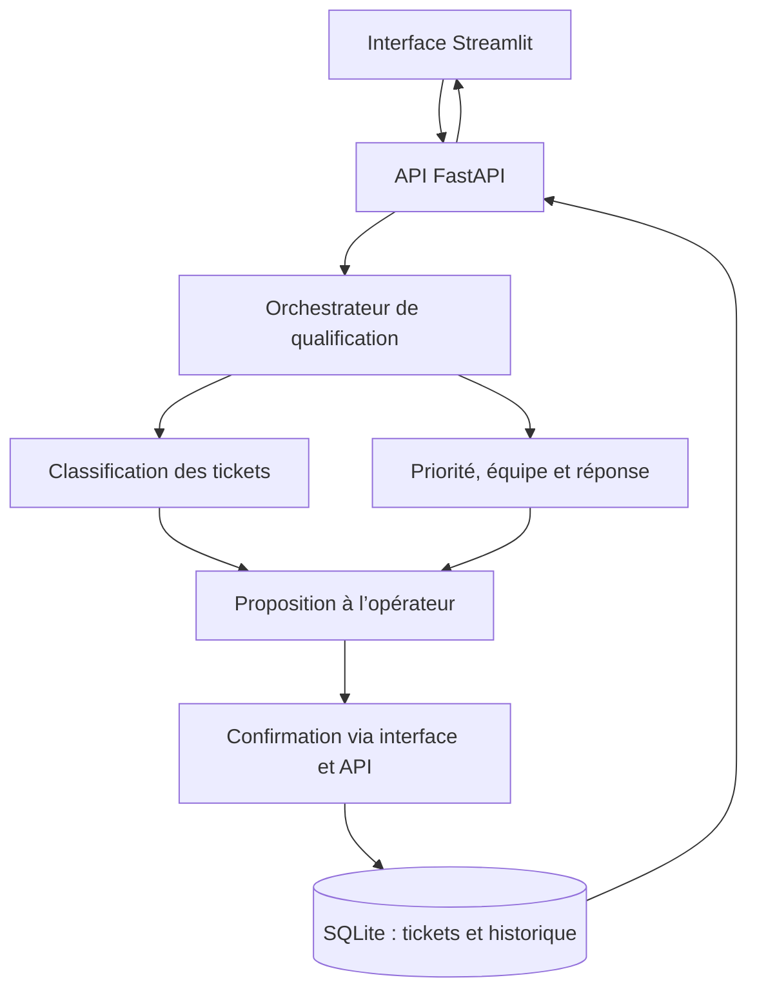

# TicketAssist — Agent intelligent de gestion des tickets IT

## 1. Présentation du projet

Le traitement initial d’un ticket informatique demande de comprendre la description du problème, d’identifier sa catégorie, d’apprécier son niveau de priorité et de choisir l’équipe compétente. Ces opérations répétitives mobilisent les techniciens avant même le début de la résolution.

TicketAssist vise à assister ce premier traitement. À partir du titre, de la description, de l’impact et de l’urgence renseignés par le demandeur, le système proposera une qualification structurée. L’opérateur conservera la possibilité de corriger et de confirmer chaque proposition avant son enregistrement.

Le projet cible un scénario de support informatique pédagogique. Aucun déploiement dans une organisation réelle ni accès à son système d’information n’est revendiqué.

## 2. Objectifs

- Classer les tickets dans quatre catégories : **réseau, matériel, logiciel et accès**.
- Déterminer une priorité à partir de règles explicites combinant l’impact et l’urgence.
- Proposer une équipe de traitement et une réponse initiale adaptée.
- Signaler les cas incertains et permettre leur validation par un opérateur.
- Enregistrer les tickets et conserver l’historique de leurs changements de statut.
- Évaluer les résultats sur des cas indépendants et documenter les erreurs et les limites.

## 3. Fonctionnalités du MVP

| Fonctionnalité prévue | Résultat attendu pour l’utilisateur |
| --- | --- |
| **F1 — Qualification** | Catégorie proposée, score du modèle, priorité calculée et équipe suggérée |
| **F2 — Assistance à la validation** | Réponse initiale, justification des règles, correction et confirmation humaines |
| **F3 — Suivi des tickets** | Identifiant, liste filtrable, statuts Nouveau / En cours / Résolu et historique |

Le MVP repose sur un **orchestrateur unique** et des modules spécialisés. Il ne revendique pas une architecture multi-agents déjà réalisée.

### Règles de priorité envisagées

| Impact déclaré | Urgence faible | Urgence normale | Urgence critique |
| --- | --- | --- | --- |
| Individuel | P4 | P4 | P3 |
| Équipe | P4 | P3 | P2 |
| Organisation | P3 | P2 | P1 |

**P1** représente la priorité la plus élevée. Cette matrice est une proposition métier à valider. Le sentiment négatif d’un message et la confiance du classifieur ne déterminent pas sa priorité.

Le seuil initial d’abstention envisagé est de **0,60**, à réévaluer sur un jeu de validation. Les propositions sous ce seuil, les cas ambigus et les tickets P1 doivent être vérifiés par un humain.

## 4. Architecture cible



| Module cible | Responsabilité |
| --- | --- |
| Orchestrateur | Enchaîner la validation des entrées, la qualification et la préparation du résultat |
| Classification | Transformer les descriptions et proposer une catégorie parmi les quatre classes |
| Règles métier | Calculer la priorité et proposer l’équipe selon des correspondances explicites |
| Réponse initiale | Produire un message contrôlé à partir de modèles de texte relus |
| Validation humaine | Corriger ou confirmer les propositions et traiter les cas incertains |
| Persistance | Enregistrer les tickets et les transitions de statut dans SQLite |

L’entraînement est effectué hors ligne. Le modèle d’analyse de sentiment actuel doit être **réentraîné sur des tickets étiquetés** avant de pouvoir servir à leur classification.

## 5. Technologies

| Couche | Technologie | Utilisation |
| --- | --- | --- |
| Langage | Python 3.11 ou 3.12 pour le démarrage documenté | API, modèle, règles et scripts |
| Apprentissage automatique | scikit-learn, TF-IDF, régression logistique | Base existante ; adaptation aux tickets prévue |
| API et contrats | FastAPI, Pydantic | Endpoints, validation des requêtes et documentation OpenAPI |
| Interfaces | Streamlit et client HTML/JavaScript | Interface existante et client des routes `/v1` |
| Stockage métier | SQLite | Persistance des tickets prévue |
| Tests et qualité | pytest, Hypothesis, Ruff, mypy, pytest-cov | Tests automatisés, typage et couverture |
| Packaging | `pyproject.toml`, setuptools, build | Paquet installable et distributions |
| Automatisation | GitHub Actions | Workflow fourni, exécution distante à contrôler |
| Conteneurisation | Docker | Prévue dans la feuille de route TicketAssist |

## 6. État des réalisations

| Élément | Statut dans les fichiers préparés |
| --- | --- |
| Modèle d’analyse de sentiment et seuil d’abstention | Disponible |
| API historique `/health` et `/predict` | Disponible |
| Routes `/v1` et clés API à deux rôles | Fournies dans le lot API v1, testées localement |
| Interface Streamlit et graphiques par lot | Disponibles |
| Explicabilité, analyse par sous-groupes et fiche modèle de sentiment | Fournies |
| Cadrage, planning et maquettes TicketAssist | Fournis dans le dossier de lancement |
| Classification des tickets et règles métier | À implémenter |
| Persistance SQLite et suivi des tickets | À implémenter |
| Conteneur Docker de TicketAssist | À réaliser |
| Validation sur tickets réels | Non réalisée : données réelles à obtenir |

Les tests et les distributions de Sentiment-app ne constituent pas une validation fonctionnelle de TicketAssist.

## 7. Organisation du dépôt

Les chemins suivants correspondent à la base technique et aux lots fournis, après leur intégration.

| Chemin | Contenu |
| --- | --- |
| `api/` | API FastAPI, schémas, raccord modèle, sécurité et routes v1 |
| `sentiment_app/` | Paquet Python et commande `sentiment` |
| `src/` | Génération des données de démonstration, entraînement et analyses |
| `ui/` | Interface Streamlit, client HTTP et graphiques |
| `web/index.html` | Client web de la v1 |
| `scripts/` | Installation, lancement et configuration locale |
| `tests/` | Tests du modèle, de l’API, des interfaces et des compléments |
| `data/sample/` | Tickets simulés et cas de test du cadrage |
| `models/` | Modèle local non versionné et métriques |
| `docs/semaine1/` | Descriptif, dataset, maquettes et pipeline du nouveau projet |
| `docs/API-V1.md` | Configuration et utilisation de l’API v1 |
| `docs/fiche-modele.md` | Caractéristiques et limites du modèle de sentiment |

## 8. Démarrage de la base Sentiment-app

Ces commandes lancent **l’application d’analyse de sentiment existante**, après intégration des lots correspondants. Elles ne lancent pas encore un gestionnaire de tickets.

Depuis CMD, à la racine du projet :

```cmd
py -3.11 -m venv .venv
.venv\Scripts\activate.bat
python -m pip install -e ".[ui]"
```

Si Python 3.12 est utilisé, remplacer `py -3.11` par `py -3.12`. Un environnement virtuel déjà compatible peut être réutilisé.

En l’absence de modèle local, générer les données puis entraîner :

```cmd
python src/make_demo.py
python src/train.py
```

Lancer l’API et garder le terminal ouvert :

```cmd
sentiment serve
```

Dans un second CMD, à la racine du même projet :

```cmd
.venv\Scripts\activate.bat
sentiment ui
```

- Interface Streamlit : <http://localhost:8501>
- Documentation de l’API : <http://127.0.0.1:8000/docs>
- Santé du service : <http://127.0.0.1:8000/health>

Le fichier `models/sentiment.joblib` reste séparé des distributions. Un chemin externe peut être indiqué avec la variable `SENTIMENT_MODELE` avant le démarrage du processus.

### Utilisation des routes v1

Après intégration du lot API v1, créer les clés localement :

```cmd
python scripts/configurer_cles_api.py
```

Le script écrit deux clés distinctes dans `.env`, sans les afficher. Une configuration existante n’est pas écrasée. Le fichier réel `.env` doit rester exclu du dépôt ; `.env.v1.example` contient uniquement un exemple vide.

| Route | Accès |
| --- | --- |
| `GET /v1/health` | Public |
| `POST /v1/predict` | Clé `client` ou `admin`, en-tête `X-API-Key` |
| `GET /v1/admin/status` | Clé `admin` |

L’API historique `/predict` reste publique pour préserver la compatibilité. L’authentification de la v1 ne constitue donc pas une protection globale de l’application.

Le client web se lance dans un terminal distinct :

```cmd
python -m http.server 8080 --bind 127.0.0.1 --directory web
```

Ouvrir <http://127.0.0.1:8080> et renseigner la clé **client**. La page ne remplace pas le serveur FastAPI, qui doit fonctionner en parallèle.

## 9. Données et évaluation

Le dossier de lancement fournit **100 tickets simulés**, répartis en quatre catégories de 25 tickets, ainsi que **20 scénarios de test proposés**, cinq par catégorie. Ces fichiers ne contiennent pas de tickets issus d’une organisation réelle.

Leur rôle est de permettre le cadrage et les premiers essais. Les formulations répétitives du corpus synthétique limitent sa représentativité. Une séparation par famille de formulation est nécessaire pour éviter qu’un même motif apparaisse à l’entraînement et au test. Les attendus du jeu de test doivent être relus et gelés avant l’évaluation.

**Un échantillon réel, autorisé et anonymisé reste à obtenir pour satisfaire l’exigence du dossier de lancement.** La licence de diffusion des données doit également être arrêtée avant publication.

| Indicateur TicketAssist | Cible proposée, non mesurée |
| --- | --- |
| F1 macro de classification | Au moins 0,80 sur un test indépendant |
| Conformité de la priorité à la matrice | 100 % des cas de règles |
| Signalement des propositions sous le seuil | 100 % |
| Persistance | Aucune création ou transition perdue silencieusement dans les scénarios testés |

L’évaluation devra aussi présenter la matrice de confusion, les effectifs par classe, le taux d’abstention et l’exactitude des réponses acceptées. Le score du modèle n’est pas une garantie de justesse.

## 10. Tests et contrôle qualité

Dans l’environnement virtuel :

```cmd
python -m pip install -r requirements-dev.txt "pytest==8.3.*"
python -m pytest -q --cov=api --cov-report=term-missing --cov-fail-under=95
python -m ruff check api
python -m mypy api
```

**Dernière vérification locale de la base avec le lot API v1, le 11 novembre 2026 :** 153 tests réussis, 4 ignorés faute d’historique Git et 3 échecs attendus documentant des limites du modèle de sentiment ; couverture des instructions de l’API de 100 %. Ces résultats concernent les fichiers préparés dans cette version de travail, pas une exécution GitHub Actions ni les fonctionnalités TicketAssist à venir.

## 11. Feuille de route

| Semaine | Livrable principal |
| --- | --- |
| 1 | Cadrage relu, données autorisées ou blocage soumis à l’enseignant, prototype en script |
| 2 | Modèle de classification, règles métier, API et premiers écrans raccordés |
| 3 | MVP complet, persistance, conteneurisation et CI vérifiées |
| 4 | Évaluation, limites documentées, notice d’installation et soutenance |

Le détail des tâches, dépendances et responsabilités figure dans le [pipeline prévisionnel](docs/semaine1/4-pipeline.md). Ce planning reste soumis à la disponibilité des données et à la validation de l’enseignant.

## 12. Équipe et contributions

| Membre | GitHub | Responsabilités proposées pour TicketAssist |
| --- | --- | --- |
| Mehdi Benjelloun | [mehdibn09](https://github.com/mehdibn09) | Cadrage, maquettes, API, interface, recette et documentation |
| Oussama Kamil | [oussamak05](https://github.com/oussamak05) | Données, modèle, règles métier, persistance, évaluation et CI |

Les contributions effectives seront établies par les commits, issues, pull requests et relectures. Chaque livrable doit être relu par l’autre membre avant fusion.

## 13. Documentation

- [Dossier de lancement](docs/semaine1/README.md)
- [Descriptif du projet](docs/semaine1/1-descriptif.md)
- [Dataset et protocole de test](docs/semaine1/2-dataset.md)
- [Architecture et maquettes](docs/semaine1/3-maquette.md)
- [Pipeline des tâches](docs/semaine1/4-pipeline.md)
- [Utilisation de l’API v1](docs/API-V1.md)
- [Fiche du modèle de sentiment](docs/fiche-modele.md)
- [Journal des TP](docs/journal-tp1-tp6.md)
- [Notice de livraison](LIVRAISON.md)

## 14. Périmètre et licence

Le MVP ne prévoit ni résolution autonome des incidents, ni exécution de commandes sur des postes, ni réinitialisation de mots de passe, ni connexion à GLPI ou ServiceNow. Les réponses initiales proviendront de modèles de texte contrôlés ; aucun RAG ou LLM n’est nécessaire au périmètre retenu.

La licence du code et celle des données doivent être explicitement définies par le binôme avant réutilisation externe. Aucune licence open source spécifique n’est revendiquée dans ce README.
