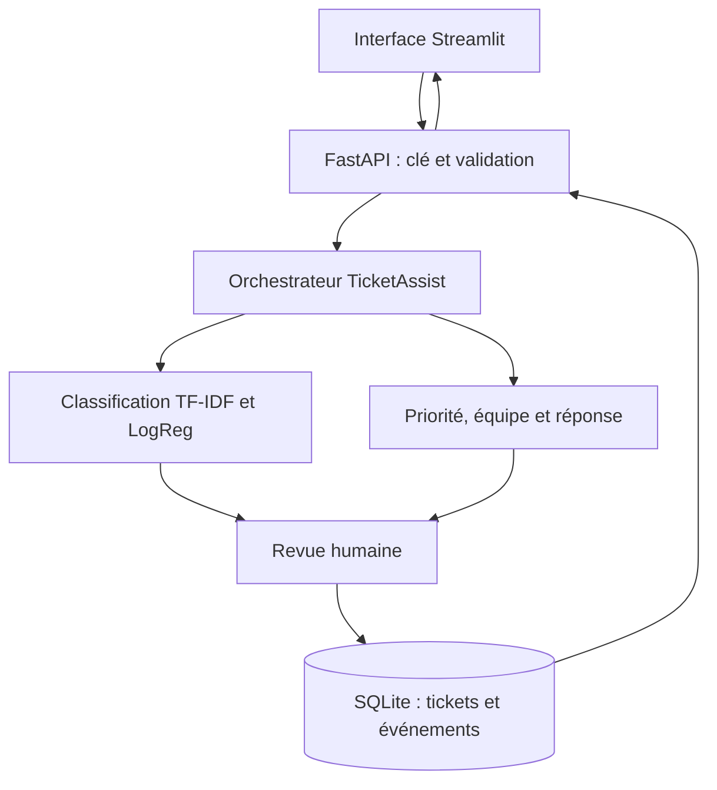
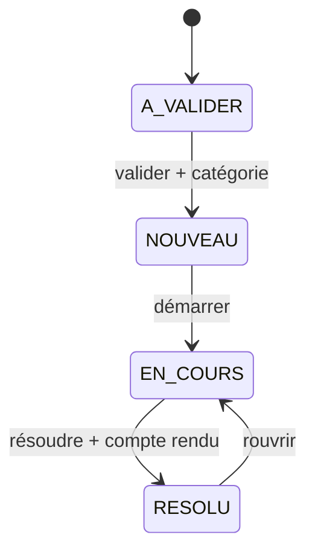

# TicketAssist — Agent de gestion des tickets IT

Qualification automatique, priorité explicable, orientation vers les équipes et suivi des tickets avec validation humaine.

**Binôme : Mehdi Benjelloun ([mehdibn09](https://github.com/mehdibn09)) et Oussama Kamil ([oussamak05](https://github.com/oussamak05)). Version 1.0.0.**

## Présentation

Un service support reçoit des demandes en texte libre. TicketAssist analyse la description, propose une catégorie et une équipe, calcule la priorité selon l’impact et l’urgence, puis prépare une réponse initiale contrôlée. Chaque ticket est enregistré en attente de validation ; un opérateur administrateur confirme sa catégorie avant sa prise en charge.

Le projet suit la démarche technique de l’exemple RAG fourni dans le cours : paquet installable, logique métier indépendante de HTTP, API FastAPI, client Streamlit, données, évaluation, tests, CI et essai d’une roue hors du dépôt. Le code et le corpus sont propres au sujet des tickets. Aucun composant RAG ou LLM n’est nécessaire pour ce périmètre.

## Fonctionnalités réalisées

| Fonction | Comportement |
| --- | --- |
| Classification | Quatre catégories : réseau, matériel, logiciel, accès ; score et abstention si texte hors vocabulaire ou confiance sous 0,45 |
| Priorité | Matrice explicite impact × urgence ; P1 est le niveau le plus élevé |
| Affectation | Équipe proposée par catégorie ; Support N1 en cas d’abstention |
| Réponse initiale | Messages contrôlés demandant les informations utiles, sans exécution de commandes |
| Validation humaine | Tout ticket commence en A_VALIDER ; validation réservée à la clé administrateur |
| Suivi | Liste paginée, filtre de statut, détail, résolution, réouverture et historique SQLite |
| Concurrence | Version attendue à chaque modification ; HTTP 409 si le ticket a déjà changé |
| Contrôle d’accès | Clés client/admin distinctes ; toutes les routes métier sont protégées |
| Explicabilité | Contributions TF-IDF au logit de la classe proposée |

L’agent ne répare pas automatiquement les équipements. Le compte rendu de résolution est renseigné par l’opérateur ; il ne constitue pas une vérification technique indépendante.

## Architecture



| Couche | Dossier | Responsabilité |
| --- | --- | --- |
| Données | `data/` | CSV simulés séparés en entraînement, validation, test et hors domaine |
| Scripts | `src/` | Entraînement, évaluation, mesure des limites, courbe d’abstention |
| Paquet | `ticket_agent/` | Classification, règles, orchestration, SQLite, configuration et CLI |
| Service | `api/` | Contrats Pydantic, authentification et routes `/v1/tickets` |
| Interface | `ui/` | Client HTTP et page ; aucun chargement du modèle ou de SQLite |
| Qualité | `tests/`, `.github/` | Tests, Ruff, mypy, packaging et intégration continue |

## Installation rapide sous Windows

Prérequis : **Python 3.11 ou 3.12**, avec le lanceur `py`. Extraire le projet et ouvrir CMD dans le dossier contenant `pyproject.toml`.

```cmd
scripts\setup.bat
scripts\lancer_web.bat
```

Le setup crée `.venv`, installe l’application et les outils de développement, génère `.env` si absent, entraîne le modèle de démonstration et calcule ses métriques. Il ne supprime pas un environnement existant ; un Python incompatible est refusé. Les scripts Windows sont fournis ; la validation d’exécution locale de cette livraison utilise Linux/Python 3.12.

L’API et l’interface restent ouvertes dans deux processus séparés. L’interface charge la clé client depuis le `.env` local. Pour valider ou changer un statut, remplacer la clé dans la barre latérale par la clé admin copiée depuis ce fichier. Ne pas communiquer la clé admin aux demandeurs.

- Interface : <http://localhost:8501>
- Documentation API : <http://127.0.0.1:8000/docs>
- Santé publique : <http://127.0.0.1:8000/health>

### Installation manuelle

```cmd
py -3.11 -m venv .venv
.venv\Scripts\activate.bat
python -m pip install -r requirements.txt -r requirements-dev.txt
ticket config
ticket train
ticket evaluate
ticket serve
```

Dans un second terminal, activer le même environnement puis lancer `ticket ui`. Si `.env` existe déjà, `ticket config` le conserve : renseigner manuellement ses deux variables de clé à partir de `.env.example`.

Linux/macOS : `bash scripts/setup.sh`, puis `bash scripts/lancer_web.sh`. En mode manuel : `python3.11 -m venv .venv`, `source .venv/bin/activate`, puis les mêmes commandes Python et `ticket`.

## Utilisation

1. Saisir un titre, une description, l’impact et l’urgence.
2. Cliquer sur **Analyser** pour consulter la proposition sans l’enregistrer, ou **Créer pour validation humaine**.
3. Ouvrir le ticket dans **Suivi et validation** avec son identifiant.
4. Avec une clé admin, choisir explicitement la catégorie et valider.
5. Démarrer le traitement, renseigner une résolution et, si nécessaire, rouvrir le ticket.



### Matrice de priorité

| Impact | Urgence faible | Urgence normale | Urgence critique |
| --- | --- | --- | --- |
| Individuel | P4 | P4 | P3 |
| Équipe | P4 | P3 | P2 |
| Organisation | P3 | P2 | P1 |

Les tickets P1 sont signalés pour escalade. Le sentiment du texte n’intervient pas dans cette matrice. Aucune catégorie proposée n’est automatiquement validée, même avec un score élevé.

## API

Dans Swagger `/docs`, utiliser **Authorize** pour saisir une clé, puis appeler les routes.

| Route | Accès | Résultat |
| --- | --- | --- |
| `GET /health`, `GET /v1/health` | Public | Disponibilité du modèle |
| `POST /v1/tickets/analyze` | Client ou admin | Analyse sans écriture |
| `POST /v1/tickets` | Client ou admin | Création A_VALIDER, HTTP 201 |
| `GET /v1/tickets` | Client ou admin | Liste paginée, filtre `statut`, `limit`, `offset` |
| `GET /v1/tickets/{id}` | Client ou admin | Ticket et historique |
| `PATCH /v1/tickets/{id}` | Admin | Transition avec contrôle de version |

Exemple de corps de création :

```json
{
  "titre": "Connexion Wi-Fi indisponible",
  "description": "Le réseau wifi ne permet plus la connexion Internet sur mon poste.",
  "impact": "individuel",
  "urgence": "normale"
}
```

Validation administrative : `{"action":"valider","version":0,"categorie":"reseau"}`. Autres actions : `demarrer`, `resoudre` avec `resolution`, et `reouvrir`. La version doit être celle renvoyée par le dernier GET.

Erreurs : 401 clé absente/invalide ; 403 rôle insuffisant ; 404 ticket absent ; 409 version dépassée ; 422 contrat ou transition invalide ; 503 modèle/clés indisponibles ; 500 erreur interne masquée. Il n’existe pas de route historique publique `/predict` contournant ces contrôles.

## Données et mesures

Les données jointes sont **entièrement simulées**, rédigées pour la démonstration : **160 tickets d’entraînement, 32 de validation, 40 de test et 12 demandes hors domaine**. Les familles de formulation et les descriptions sont séparées entre jeux ; les variantes d’un même motif restent à l’entraînement. Les étiquettes sont proposées, sans validation par un service support réel.

| Mesure sur le test simulé | Valeur |
| --- | --- |
| F1 macro, catégorie la plus probable | 0.975 |
| Exactitude brute | 97.5% |
| Couverture au seuil 0,45 | 97.5% |
| Exactitude parmi les cas acceptés | 97.4% |

Source des chiffres : [`models/metrics.json`](models/metrics.json), recalculé par `ticket evaluate`. Les mesures du modèle de sentiment précédent et celles du projet RAG ne sont pas reprises. Ce petit test construit avec les mêmes conventions linguistiques peut être optimiste ; il ne valide pas un usage en entreprise. Le diagnostic hors domaine et la liste des erreurs sont disponibles dans `models/diagnostic.json`.

**Le critère pédagogique exigeant des tickets réels reste à satisfaire** par un export autorisé et anonymisé, ou une dérogation de l’enseignant. L’application est fonctionnelle avec le corpus de démonstration sans téléchargement, LLM ou service payant.

```cmd
ticket analyze "Mon compte utilisateur est verrouillé."
ticket explain "Le réseau wifi ne donne plus de connexion Internet."
python src/courbe_seuil.py
python src/mesurer.py
```

La courbe de seuil utilise uniquement la validation. Le jeu de test ne doit pas servir au réglage. Voir [données et import d’un corpus réel](data/README.md).

## Tests et qualité

```cmd
python -m pytest -q --cov=ticket_agent --cov=api --cov=ui.client --cov-report=term-missing --cov-fail-under=85
python -m ruff check .
python -m mypy ticket_agent api ui src scripts
```

Les tests couvrent notamment les clés et rôles, les erreurs HTTP, l’abstention, la matrice métier, les transitions, les écritures atomiques, les modifications concurrentes, la persistance et les interactions Streamlit via une API en mémoire. Les résultats exacts de cette livraison sont dans [`docs/validation-locale.txt`](docs/validation-locale.txt).

La CI fournie cible Python 3.11 et 3.12, entraîne et évalue le modèle, teste le projet, construit les distributions et essaie la roue hors du dépôt. Un second job construit Docker. Une réussite locale ne prouve pas que les jobs GitHub ont déjà tourné.

## Docker

Créer d’abord `.env` avec les deux clés, puis :

```sh
docker compose up --build
```

Le modèle de démonstration est entraîné pendant la construction. Les tickets sont conservés dans le volume SQLite `tickets`. Les ports sont publiés uniquement sur `127.0.0.1`. La page Docker ne reçoit pas la clé admin automatiquement : renseigner la clé souhaitée dans la barre latérale. Docker n’étant pas disponible dans l’environnement de préparation, le démarrage des conteneurs reste à confirmer ; le workflow inclut son contrôle.

## Paquet installable

```cmd
python -m build
```

La roue contient `ticket_agent`, `api` et `ui`. Le modèle, la base de tickets et les données ne sont pas embarqués. Pour une roue installée ailleurs, définir `TICKET_MODEL` vers un modèle reconstruit avec les mêmes dépendances, et `TICKET_DB` vers un fichier accessible en écriture. Le paquet source contient les CSV de démonstration et les scripts pour reconstruire le modèle.

## Équipe, documentation et périmètre

| Membre | Répartition de référence |
| --- | --- |
| Mehdi Benjelloun | Cadrage, API, interface et documentation |
| Oussama Kamil | Données, modèle, règles, persistance et évaluation |

Cette répartition est à confirmer par les contributions effectives ; aucun commit ou visa de relecture individuel n’est inventé.

- [Cadrage](docs/cadrage/agent-tickets.md)
- [Maquettes des parcours](docs/maquettes.md)
- [Évaluation et limites](docs/evaluation.md)
- [Fiche modèle](docs/fiche-modele.md)
- [Compte rendu de livraison](docs/compte-rendu.md)
- [Dossier de lancement](DOSSIER-LANCEMENT.md)
- [Installation et dépannage](LIVRAISON.md)
- [Migration depuis Sentiment-app](MIGRATION.md)
- [Provenance](PROVENANCE.md)
- [Versions](CHANGELOG.md)

Le démonstrateur utilise deux rôles partagés, pas des comptes individuels ni une séparation par demandeur. Les clés client peuvent consulter l’ensemble des tickets. Il ne fournit ni connecteur GLPI/ServiceNow, ni SLA contractuel, ni monitoring des postes, ni réparation autonome. Les données personnelles et les secrets ne doivent pas être introduits dans le dépôt ; `.env`, SQLite et les modèles sont exclus de Git. Ne charger que des modèles joblib de confiance. La licence de diffusion du code et des données reste à choisir par leurs titulaires.
