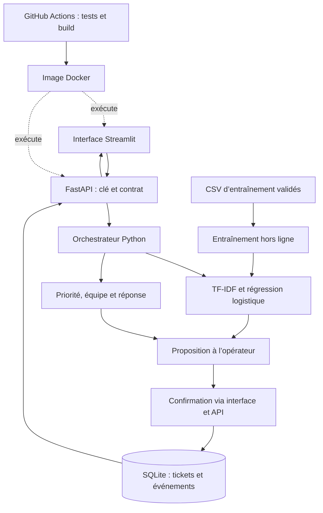
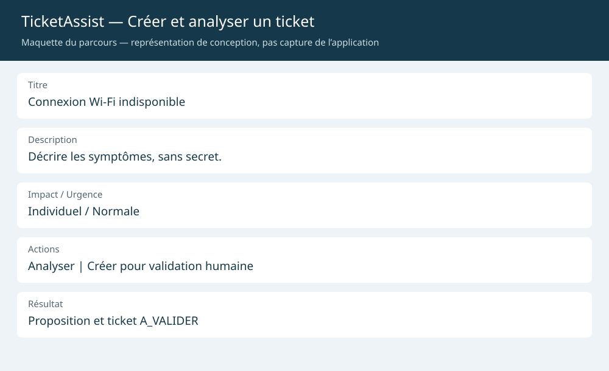
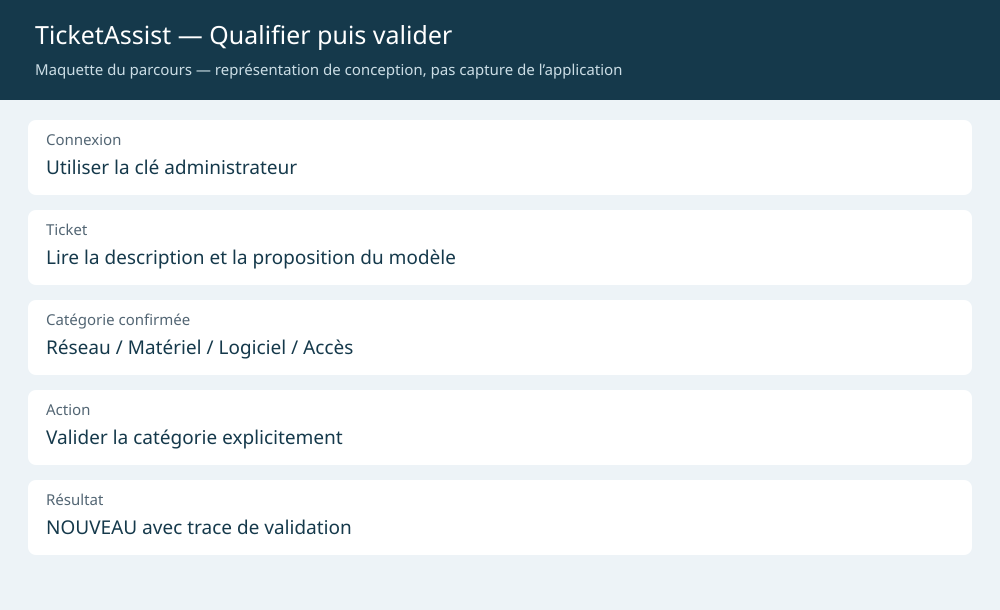
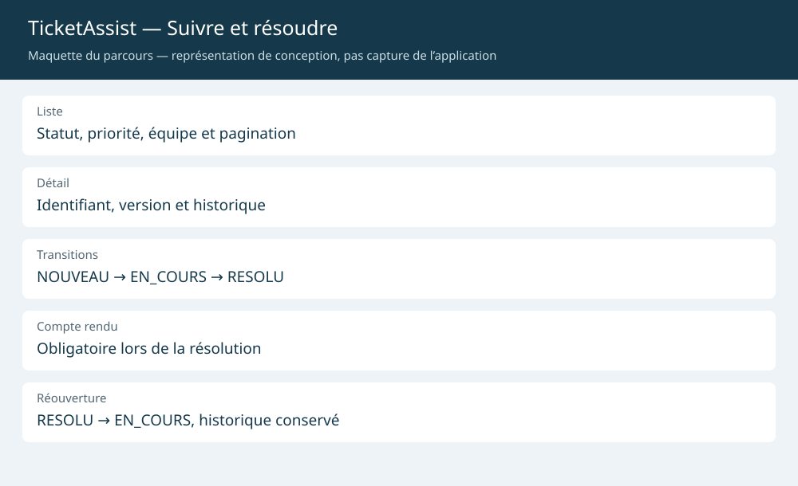

## Livrable 3 — Maquette globale et architecture

**Rédacteur responsable : Mehdi Benjelloun** · Relecteur : Oussama Kamil · Visibilité GitHub à contrôler après intégration.

### 3.1 Architecture du système

La première analyse ne persiste rien. La création écrit le ticket `A_VALIDER`. L’opérateur confirme ensuite une catégorie par une requête authentifiée avant traitement. La validation représente une action humaine dans l’interface ; elle n’est pas une décision automatique du classifieur.

### 3.2 Légende et traçabilité fonctionnelle

| Composant | Fonction servie | Responsabilité |
| --- | --- | --- |
| Streamlit | F1–F3 | Saisie, proposition, filtre, détail et actions de l’opérateur |
| FastAPI et clés | F1–F3 | Valider les requêtes, contrôler le rôle, renvoyer les erreurs |
| Orchestrateur | F1/F2 | Coordonner classification, règles et réponse initiale |
| TF-IDF/LogReg | F1 | Proposer une catégorie et un score ; abstention sous seuil |
| Règles | F1/F2 | Priorité à neuf cas, équipe et gabarit de réponse |
| Confirmation humaine | F2/F3 | Confirmer la catégorie ; les cas P1/incertains sont signalés |
| SQLite | F3 | Conserver tickets, compte rendu, événements et version de modification |
| CSV et entraînement | F1 | Reconstruire le modèle ; aucun apprentissage sur les saisies en production |
| CI et Docker | Transverse | Tester et empaqueter ; exécution distante/conteneur encore à confirmer |

### 3.3 Maquettes des écrans

| Vue | Image fournie | Fonctions | Action principale |
| --- | --- | --- | --- |
| Création et analyse | `docs/semaine1/img/creation.svg` | F1/F2 | Décrire le problème, analyser puis créer |
| Qualification et validation | `docs/semaine1/img/validation.svg` | F1/F2 | Corriger ou confirmer la catégorie avec une clé admin |
| Liste, détail et historique | `docs/semaine1/img/suivi.svg` | F3 | Filtrer, ouvrir, démarrer, résoudre ou rouvrir |

Les images sont des **maquettes de conception**, pas des captures d’exécution. L’interface réelle regroupe création/analyse, suivi/validation et documentation en trois onglets ; les vues métier ci-dessous représentent ses parcours.

### 3.4 Parcours et gestion des exceptions

Création → proposition → enregistrement `A_VALIDER` → revue admin → `NOUVEAU` → `EN_COURS` → `RESOLU` avec compte rendu. Une réouverture retourne à `EN_COURS`. L’ancienne résolution demeure dans les événements.

Une clé client ne valide pas de ticket. Une version dépassée produit HTTP 409 et impose de recharger la fiche. Une saisie invalide ou une transition interdite produit 422. Un modèle indisponible bloque l’analyse, mais la consultation reste possible si la base est accessible. Aucune route publique de prédiction ne contourne les rôles.

**Contrôle de préparation :** trois images présentes ; création et revue admin exercées par les tests Streamlit ; cycle complet vérifié sur serveur local. **Validation attendue :** affichage GitHub, recette sur les postes du binôme et visa du relecteur.
