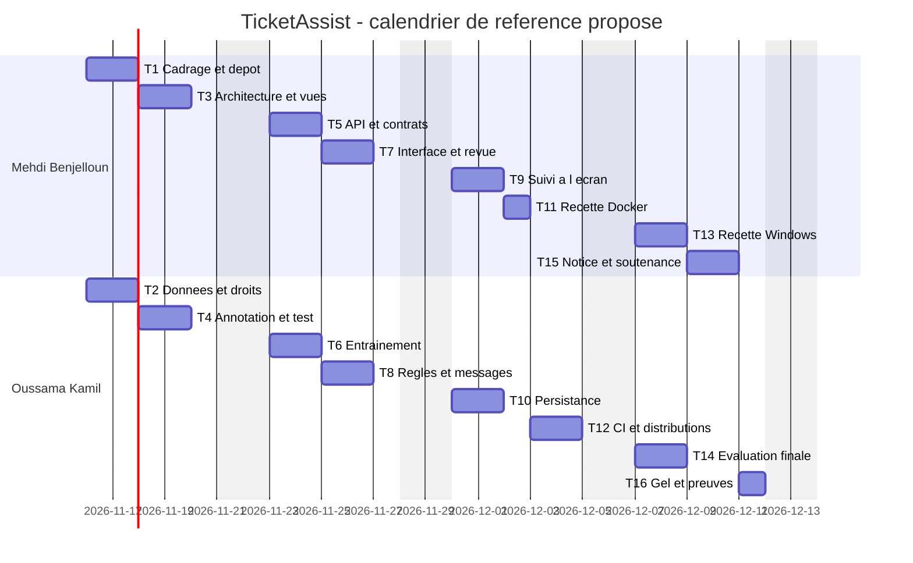

## Livrable 4 — Pipeline, jalons et maîtrise des risques

**Consolidateur : Oussama Kamil** · Relecteur : Mehdi Benjelloun · Chaque membre doit saisir lui-même ses tâches dans les issues GitHub.

### 4.1 Tâches et critères de fin

Le planning ci-dessous est un **calendrier de référence proposé** pour la consolidation et la validation du projet. Il n’attribue pas rétrospectivement des jours de travail aux composants déjà préparés. Chaque tâche dure un à deux jours ; son statut GitHub reste à établir.

| ID | Tâche | Fonction | Responsable | Dépend de | Sem. | Jours | Critère de fin |
| --- | --- | --- | --- | --- | --- | --- | --- |
| T1 | Consolider dépôt, périmètre et contrats | Transverse | Mehdi | — | 1 | 2 | Arborescence propre, trois fonctions et matrice relues |
| T2 | Obtenir les droits et préparer l’échantillon | F1 | Oussama | — | 1 | 2 | Export réel autorisé/anonymisé ou blocage soumis ; échantillon lisible |
| T3 | Formaliser maquettes et parcours | F1–F3 | Mehdi | T1 | 1 | 2 | Trois vues et architecture relues |
| T4 | Relire les labels et geler les jeux | F1/F2 | Oussama | T2 | 1 | 2 | Aucune famille partagée, test indépendant et attendus approuvés |
| T5 | Vérifier API, contrats et erreurs | F1–F3 | Mehdi | T3/T4 | 2 | 2 | Routes documentées, entrées invalides refusées |
| T6 | Reproduire entraînement et classification | F1 | Oussama | T4 | 2 | 2 | Modèle chargeable, métriques et empreintes enregistrées |
| T7 | Raccorder saisie et revue humaine | F1/F2 | Mehdi | T5/T6 | 2 | 2 | Création A_VALIDER et confirmation admin démontrées |
| T8 | Valider règles et messages | F1/F2 | Oussama | T1/T6 | 2 | 2 | Neuf priorités et équipes contrôlées ; gabarits relus |
| T9 | Finaliser suivi et historique à l’écran | F3 | Mehdi | T7/T8 | 3 | 2 | Liste, filtre et détail vérifiés sur contrats stabilisés |
| T10 | Vérifier persistance et concurrence | F3 | Oussama | T5/T8 | 3 | 2 | Reprise après redémarrage et conflit de version testés |
| T11 | Recetter le conteneur | Transverse | Mehdi | T9/T10 | 3 | 1 | Docker démarre avec modèle et volume persistants |
| T12 | Exécuter CI et vérifier les distributions | Transverse | Oussama | T9/T10/T11 | 3 | 2 | Jobs verts et roue essayée hors dépôt |
| T13 | Réaliser la recette sur poste Windows | F1–F3 | Mehdi | T11/T12 | 4 | 2 | Installation et cycle utilisateur rejoués sans blocage |
| T14 | Finaliser évaluation et limites | F1/F2 | Oussama | T6/T12 | 4 | 2 | Résultats, abstentions et erreurs documentés avec leur provenance |
| T15 | Préparer notice et scénario de soutenance | Transverse | Mehdi | T13/T14 | 4 | 2 | Installation expliquée et démonstration chronométrée |
| T16 | Geler la version et consolider les preuves | Transverse | Oussama | T14/T15 | 4 | 1 | Tag, bilans et contributions vérifiables |

### 4.2 Jalons hebdomadaires

| Semaine proposée | Jalon démontrable | Tâches |
| --- | --- | --- |
| 16–22 novembre | Dossier relu, décision sur les données, prototype en script reproductible | T1–T4 |
| 23–29 novembre | Qualification exposée en API et revue humaine raccordée | T5–T8 |
| 30 novembre–6 décembre | MVP intégré, persistance et Docker/CI vérifiés | T9–T12 |
| 7–13 décembre | Recette, résultats contextualisés, code gelé et soutenance préparée | T13–T16 |

### 4.3 Vue chronologique

### 4.4 Chemin critique, charge et risques

**Chaîne de dépendances à surveiller :** données/labels T2–T4 → API et modèle T5–T6 → interface et règles T7–T8 → suivi/persistance T9–T10 → Docker T11 → CI T12 → recette/évaluation T13–T14 → démonstration T15 → gel T16. T1–T3 alimentent également T5. Le planning contient des marges ; tout retard ne décale pas mécaniquement la soutenance. Un blocage durable sur les données remet en cause la validation académique.

**Charge :** Mehdi 15 jours, Oussama 15 jours ; 30 jours-personnes, écart nul. La réserve non affectée de chaque semaine sert aux corrections et aux retours de relecture. Les dates doivent être confirmées avec celles du cours.

| Risque | Mesure prévue | Responsable de suivi |
| --- | --- | --- |
| Aucun corpus réel autorisé | Présenter le blocage dès S1 ; obtenir un export ou une dérogation | Oussama |
| Score simulé surinterprété | Distinguer prototype et performance métier ; conserver les erreurs | Oussama |
| Fuite de clé ou de données | `.env`, SQLite et modèles hors Git ; échantillon anonymisé avant dépôt | Mehdi |
| Écart entre postes et CI | Recette Windows, conteneur, test de roue et journal de versions | Les deux |

**Contrôle de préparation :** tâches courtes, critères observables et charge équilibrée. **Validation attendue :** dates, saisie personnelle, issues et preuves de fin réellement produites.
